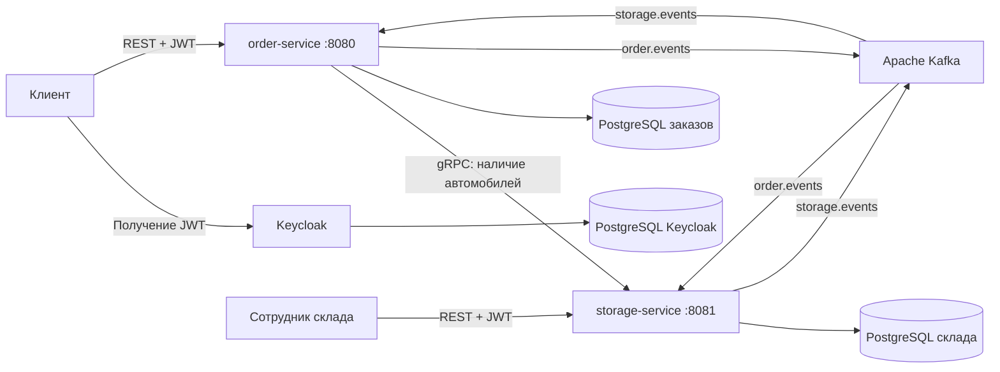

# Car Dealership

**От доменной модели на Java до микросервисов с Kafka и gRPC.**

Backend автосалона: каталог автомобилей и комплектаций, конфигуратор, заказы,
тест-драйвы и склад. Проект развивался в пяти этапах: каждая ветка сохраняет
реализацию соответствующей лабораторной, а `main` содержит последнюю версию
и документацию для знакомства с проектом.

## Развитие архитектуры

| Этап | Ветка | Реализация |
| --- | --- | --- |
| 1 | [lab-1](https://github.com/322moon/car-dealership/tree/lab-1) | Доменная модель, конфигуратор, бизнес-правила, репозитории в памяти, JUnit |
| 2 | [lab-2](https://github.com/322moon/car-dealership/tree/lab-2) | Монолит на Spring Boot: REST API, JPA, PostgreSQL, миграции Liquibase |
| 3 | [lab-3](https://github.com/322moon/car-dealership/tree/lab-3) | Spring Security, Keycloak, проверка JWT, роли и ограничения доступа к заказам |
| 4 | [lab-4](https://github.com/322moon/car-dealership/tree/lab-4) | Выделение order-service и storage-service, отдельные БД, Kafka, Outbox/Inbox |
| 5 | [lab-5](https://github.com/322moon/car-dealership/tree/lab-5) | gRPC-запросы наличия автомобилей, Protobuf, deadline и обработка ошибок |

Ветки отражают последовательные этапы одного проекта. Для сравнения решений:

- [Доменная модель → REST и БД](https://github.com/322moon/car-dealership/compare/lab-1...lab-2)
- [Добавление безопасности](https://github.com/322moon/car-dealership/compare/lab-2...lab-3)
- [Монолит → микросервисы](https://github.com/322moon/car-dealership/compare/lab-3...lab-4)
- [Добавление gRPC](https://github.com/322moon/car-dealership/compare/lab-4...lab-5)

Исходные состояния также отмечены тегами `stage-01-domain`,
`stage-02-rest-persistence`, `stage-03-security-keycloak`,
`stage-04-kafka-microservices`, `stage-05-grpc`.

## Текущая архитектура



| Модуль | Ответственность |
| --- | --- |
| `order-service` | Заказы, клиентский каталог, конфигуратор, тест-драйвы, REST-вход в gRPC-запросы наличия |
| `storage-service` | Складской каталог, резервирование остатков, обработка заявок на сборку, gRPC-сервер |
| `common-events` | Общие контракты событий и Protobuf-контракт доступности автомобилей |

**Kafka** обслуживает асинхронный жизненный цикл заказа. **gRPC** используется
для синхронного чтения наличия автомобилей со склада. Подробности:
[архитектурные решения и потоки данных](docs/architecture.md).

## Стек

Java 21 · Spring Boot 3.5.11 · Spring Security · OAuth2 Resource Server ·
Keycloak · Spring Data JPA · PostgreSQL 16 · Liquibase · Apache Kafka ·
gRPC / Protobuf · Gradle Wrapper · Docker Compose · JUnit 5 · Testcontainers.

## Быстрый запуск

Понадобятся Git и Docker с Compose. Образы приложений собираются внутри Docker;
локальная Java для этого варианта не требуется.

```bash
git clone https://github.com/322moon/car-dealership.git
cd car-dealership
docker compose -f docker/docker-compose.yml up --build -d
```

Первый запуск загружает образы и зависимости. `depends_on` задаёт порядок
старта контейнеров, но не проверяет готовность PostgreSQL, Kafka и Keycloak.
Если приложение завершилось при первом старте, дождись запуска инфраструктуры
и перезапусти сервисы:

```bash
docker compose -f docker/docker-compose.yml logs --tail=100 order-service storage-service
docker compose -f docker/docker-compose.yml restart order-service storage-service
```

| Компонент | Адрес на хосте |
| --- | --- |
| Order API / Swagger UI | http://localhost:8080/swagger-ui/index.html |
| Storage API / Swagger UI | http://localhost:8081/swagger-ui/index.html |
| Keycloak | http://localhost:8180 |
| PostgreSQL заказов | `localhost:5433` |
| PostgreSQL склада | `localhost:5434` |
| Kafka | `localhost:9092` |
| Storage gRPC | `localhost:9090` |

Остановить контейнеры:

```bash
docker compose -f docker/docker-compose.yml down
```

Compose и импорт realm настроены для локальной демонстрации и содержат
тестовые учётные записи. Данные БД приложений не закреплены в named volumes;
после удаления и пересоздания контейнеров они создаются заново миграциями.

## Авторизация и пример запроса

Realm: `car-dealership`. Public client: `car-dealership-api`.
Роли: `USER`, `MANAGER`, `WAREHOUSE_ADMIN`, `ADMIN`.
Тестовые пользователи находятся в
[`docker/keycloak/car-dealership-realm.json`](docker/keycloak/car-dealership-realm.json).
Консоль Keycloak для локального стенда: `admin` / `admin`.

Получить токен тестового пользователя, подставив пароль из импорта realm:

```bash
read -s DEMO_PASSWORD
TOKEN=$(curl --fail --silent --show-error \
  -X POST http://localhost:8180/realms/car-dealership/protocol/openid-connect/token \
  -H 'Content-Type: application/x-www-form-urlencoded' \
  --data-urlencode 'client_id=car-dealership-api' \
  --data-urlencode 'grant_type=password' \
  --data-urlencode 'username=customer' \
  --data-urlencode "password=$DEMO_PASSWORD" \
  | python3 -c 'import json,sys; print(json.load(sys.stdin)["access_token"])')
unset DEMO_PASSWORD

curl --fail --silent --show-error http://localhost:8080/api/v1/cars \
  -H "Authorization: Bearer $TOKEN"
```

Для этого примера на хосте нужны `curl` и Python 3.
Запрос идёт в `order-service`, который получает доступные автомобили из
`storage-service` по gRPC. Отсутствующий автомобиль возвращает HTTP 404,
недоступность gRPC-сервиса или превышение deadline — HTTP 503.

## Сборка и тесты

Для сборки вне Docker установи JDK 21. Gradle запускается через wrapper:

```bash
./gradlew clean assemble
./gradlew test
./gradlew integrationTest
```

Интеграционные тесты требуют работающего Docker и используют Testcontainers
с PostgreSQL. Тесты order-service поднимают тестовый gRPC-сервер;
тесты storage-service обращаются к его gRPC API. Эти тесты не заменяют
проверку полного сценария двух сервисов с Kafka и Keycloak.

[GitHub Actions](https://github.com/322moon/car-dealership/actions/workflows/ci.yml)
в `main` запускает сборку, модульные и интеграционные тесты на Java 21.

## Структура

```text
common-events/       # События и Protobuf-контракт
order-service/       # Клиентские сценарии и заказы
storage-service/     # Склад и обработка заявок
docker/              # Dockerfile, Compose и импорт Keycloak
docs/                # Описание архитектуры
.github/workflows/   # CI
```

## История проекта

Проект вырос из учебного шаблона
[is-tech-y28/322moon_template](https://github.com/is-tech-y28/322moon_template).
История коммитов и авторство сохранены. Ветки `lab-*` оставлены в исходном
виде; документация и настройка Java 21 в CI добавлены в `main`.
