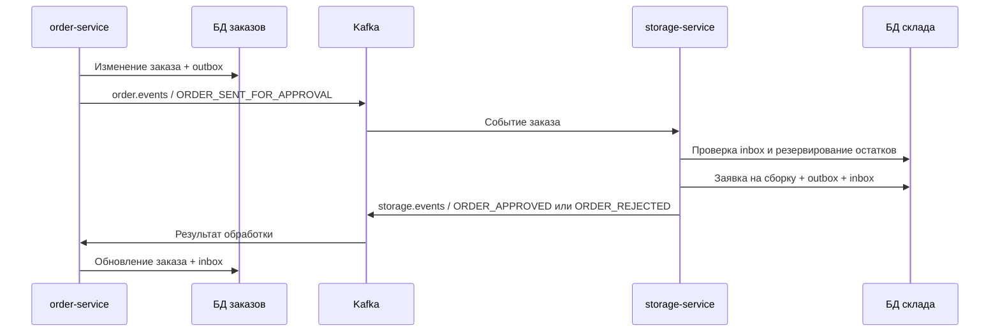
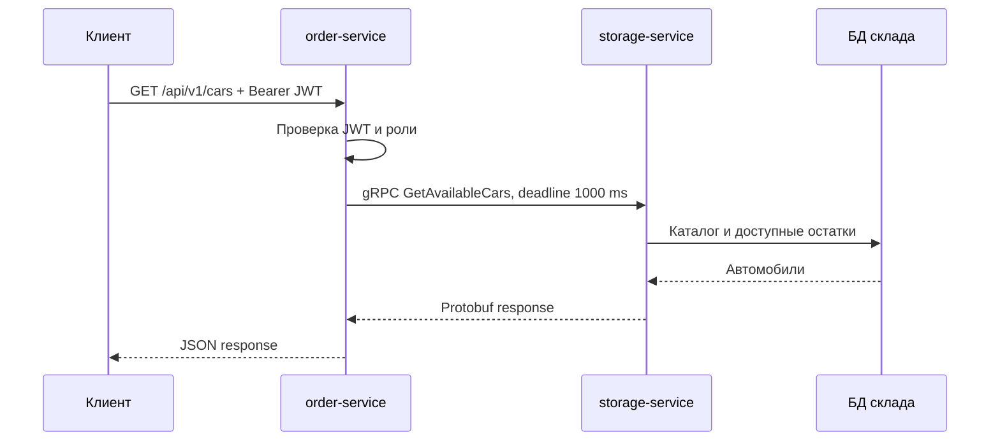

# Архитектура Car Dealership

## Переход от монолита

В `lab-1` бизнес-правила и доменные сущности работают с репозиториями в памяти.
В `lab-2` появляются HTTP-контроллеры, persistence-адаптеры, JPA и PostgreSQL.
В `lab-3` монолит становится OAuth2 Resource Server: Keycloak выдаёт JWT,
Spring Security проверяет их и преобразует realm roles в authorities.

В `lab-4` склад выделен в отдельный процесс со своей БД. События Kafka связывают
работу с заказами и резервирование остатков. В `lab-5` добавлено синхронное
чтение доступных автомобилей через gRPC. У каждого этапа сохранена своя ветка;
ссылки на сравнения находятся в [README](../README.md#развитие-архитектуры).

## Асинхронная обработка заказа

Outbox publisher выбирает до 20 новых событий за проход; интервал по умолчанию —
5 секунд. После подтверждения отправки Kafka запись помечается как `PUBLISHED`.
Неудачная отправка увеличивает число попыток; после пяти попыток событие получает
статус `FAILED`. Автоматическая повторная отправка записей `FAILED` не реализована.

Проверка `eventId` в Inbox позволяет пропускать уже обработанные события.
Повторная доставка возможна: отправка в Kafka и фиксация статуса в PostgreSQL
не являются одной общей транзакцией. При оценке конкурентной обработки также
нужно учитывать уникальность `eventId` и границы транзакций.

## Синхронный запрос наличия

Контракт находится в `common-events/src/main/proto/car_availability.proto`.
Доступны `GetAvailableCars` и `GetAvailableCarById`.
Клиент задаёт deadline через `grpc.storage.timeout-ms`.

## Границы демонстрационной реализации

- HTTP API защищены Spring Security и Keycloak. Внутренний gRPC-канал использует
  plaintext; отдельная аутентификация и TLS для него не настроены.
- Compose использует локальные тестовые credentials и режим Keycloak `start-dev`.
- Готовность инфраструктуры при старте не контролируется healthchecks.
- Автоматическое восстановление событий со статусом `FAILED` не реализовано.
- В микросервисной версии остаются клиентские структуры каталога внутри
  order-service; выделение склада не означает полного устранения дублирования.

Эти ограничения описывают текущий учебный стенд. Проверка production-развёртывания
и нагрузочного поведения не входит в заявленную функциональность проекта.
